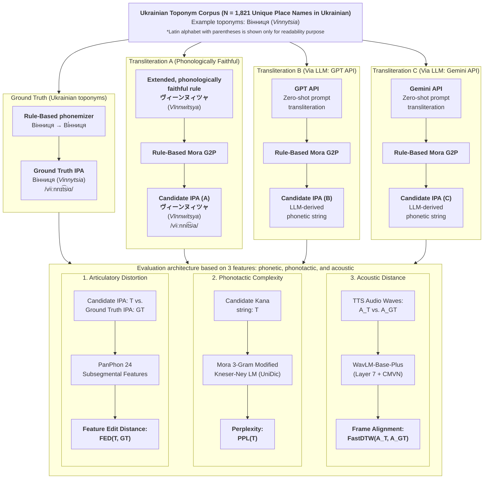

# Ukrainian Toponym Transliteration into Japanese: A Multi-Dimensional Quantitative Evaluation

[](https://www.python.org/downloads/release/python-3110/)

This repository contains the official codebase and dataset for R&D project I am conducting at **Uppsala University (Master's Programme on Language Technology)**.

The project evaluates rule-based transliteration against transliterations generated by state-of-the-art Large Language Models (OpenAI GPT-4o-mini and Google Gemini 3.5 Flash). The rules are made by the author of this project, preserving Ukrainian charasteristics as much as possible, given naturalness of Japanese Katakana sequences.

---

## Research Overview
Preprocessing with `preprocessing/Ukrainian toponyms retrieval.py` and `preprocessing/expand_transliteration.py` for `raw/Ukrainian toponyms corpus.csv` and `intermediate/ukrainian_toponyms_wikiinfo.csv`, I prepare data: `processed/ukrainian_toponyms_wikiinfo_with_accent_ja.csv`. In the data, there is rule-based transliteration for Ukrainian toponyms into Japanese Katakana based on below criteria:
1. **Phonetic & Acoustic Fidelity**: Preserving Ukrainian pronunciation (vowels, palatalized consonants, consonant clusters, etc.).
2. **Japanese Phonotactic Naturalness**: Complying with Japanese morae constraints and ensuring naturalness of Japanese Katakana sequences.
3. **Sociolinguistic Entrenchment**: Following conventionalized or popular established toponyms (e.g., *Kyiv* as `キーウ`, *Odesa* as `オデーサ`).

### Multi-Dimensional Evaluation Framework
To evaluate the extent of the performance, acoustic fideility of Ukrainian, and naturalness of Japanese Katakana sequences, our pipeline measures three dimensions:

| Dimension | Metric | Implementation & Theoretical Rationale |
| :--- | :--- | :--- |
| **Phonetic Distance** | **Feature Edit Distance (FED)** | PanPhon 24-dimensional articulatory distinctive features (Mortensen et al., 2016) comparing Ukrainian IPA (with post-1989 tie-bar affricate normalization and stressed vowel length) to Japanese IPA. |
| **Phonotactic Naturalness** | **Perplexity (PPL)** | Mora-level Interpolated Modified Kneser-Ney 3-gram language model (count-specific discounts $D_1, D_2, D_{3+}$ and 0th-order uniform prior over the 841-mora inventory; Chen & Goodman, 1999) trained on 50,000 Katakana lexical items extracted from UniDic-lite (Den et al., 2008). |
| **Acoustic Fidelity** | **Normalized Acoustic Distance** | Layer 7 representations (with utterance-level CMVN and silence trimming) from WavLM-Base-Plus (Chen et al., 2022) aligned via Dynamic Time Warping (FastDTW, cosine distance), comparing Ukrainian VITS TTS against IPA-conditioned Japanese Kokoro-82M Neural ONNX TTS (`jm_kumo`). |

As for Sociolinguistic Factor, we compare the popularity of established toponyms with rule-based transliterations using Knee Point Detection (Satopaa et al., 2011) over 2-year average Wikipedia pageviews to conclude if the toponym is conventional or rule-based.



---

## Repository Structure

```
ukrainian-toponym-transliteration/
├── src/                                      # Modular source code
│   ├── toponym_evaluate_pipeline.py          # Pipeline orchestrator (multi-run LLM averaging & caching)
│   ├── ukrainian_g2p.py                      # Ukrainian G2P (ukrainian-word-stress + IPA normalization)
│   ├── japanese_g2p.py                       # Deterministic mora-level Katakana-to-IPA G2P
│   ├── fed_evaluator.py                      # Feature Edit Distance (PanPhon 24 features)
│   ├── perplexity_evaluator.py               # Phonotactic complexity (Interpolated Modified Kneser-Ney 3-gram PPL)
│   ├── acoustic_distance_evaluator.py        # WavLM-Base-Plus Layer 7 (CMVN) + FastDTW acoustic distance
│   ├── audio_generator.py                    # Ukrainian (ESPnet VITS) & Japanese (Kokoro-82M Neural ONNX) TTS
│   ├── rulebased_transliteration.py          # Hybrid rule-based + Wikipedia pageview threshold selector
│   ├── llm_batch_utils.py                    # Shared 1-based batch JSON recovery, pacing & quota error handling
│   ├── gpt_transliterator.py                 # OpenAI GPT-4o-mini (Single & 1-based JSON Batch)
│   ├── gemini_transliteratior.py             # Google Gemini-3.5-flash-lite (Single & 1-based JSON Batch)
│   ├── wikipedia_pageviews_inflection_point_detector.py # Kneedle knee-point detection
│   └── README.md                             # Technical architecture & module documentation
│
├── data/                                     # Lexical and toponym datasets
│   ├── raw/                                  # Seed datasets
│   │   └── Ukrainian toponyms corpus.csv     # Raw Ukrainian toponyms & baseline Katakana
│   ├── intermediate/                         # Harvested Wikipedia/Wikidata metadata
│   │   └── ukrainian_toponyms_wikiinfo.csv   # Pageviews, oblast, coordinates, accents
│   └── processed/                            # Experiment benchmark datasets
│       └── ukrainian_toponyms_wikiinfo_with_accent_ja.csv # Accent-expanded master dataset
│
├── preprocessing/                            # Data harvesting & phonological expansion engines
│   ├── Ukrainian toponyms retrieval.py       # Wikipedia / Wikidata API harvesting script
│   ├── expand_transliteration.py             # Phonological rule & accent expansion script
│   └── README.md                             # Preprocessing pipeline documentation
│
├── results/                                  # Generated evaluation results, tables, and figures
│   ├── ukrainian_toponyms_evaluation_results.csv # Full multi-dimensional evaluation results (5,554 records)
│   ├── established_toponyms_table.csv        # Toponyms exceeding the knee-point threshold (190 unique)
│   └── wikipedia_pageview_knee_analysis.png  # Knee-point detection plot (Rank: 213, 533.8 views/mo)
│
├── LICENSE                                   # MIT License
├── requirements.txt                          # Pinned direct dependencies
├── .gitignore                                # Excludes audio caches, models, and secrets
└── README.md                                 # This document
```

---

## Quickstart Guide

### 1. Installation
Clone the repository and install the dependencies in a Python 3.11 environment:

```bash
git clone https://github.com/katsufu/ukrainian-toponym-japanese-transliteration.git
cd ukrainian-toponym-japanese-transliteration

# Create and activate conda environment
conda create -n <env_name> python=3.11 -y
conda activate <env_name>

# Install all pinned dependencies (includes torch==2.10.0, torchaudio==2.10.0, onnxruntime, unidic-lite, etc.)
pip install -r requirements.txt

# Verify core imports and version alignment
python -c "import torch, torchaudio, transformers, onnxruntime, panphon, unidic_lite; print('OK! Torch:', torch.__version__, 'Torchaudio:', torchaudio.__version__)"
```

> **Note on `torch` / `torchaudio` Version Alignment & `torchvision`**:
> * `torch` and `torchaudio` must share the exact same release version (`2.10.0`, pinned in `requirements.txt`). If they drift apart (e.g., `torch 2.12.x` with `torchaudio 2.11.x`), importing `torchaudio` will fail with `OSError: ... libtorchaudio.so: undefined symbol`. Re-align them via:
>   ```bash
>   pip install "torch==2.10.0" "torchaudio==2.10.0"
>   ```
> * `torchvision` is **not** used in this repository. If an existing environment has an older `torchvision` installed that causes pip dependency conflict warnings or `transformers` import errors, remove it via:
>   ```bash
>   pip uninstall -y torchvision
>   ```

### 2. Environment Variables (UTF-8 & LLM API Keys)
Set UTF-8 mode and your LLM API keys in your terminal session (never hardcode API keys in scripts):

```bash
export PYTHONUTF8=1
export OPENAI_API_KEY="your-openai-api-key"
export GEMINI_API_KEY="your-gemini-api-key"
```

*(On Windows PowerShell, use `$env:PYTHONUTF8="1"`, `$env:OPENAI_API_KEY="..."`, and `$env:GEMINI_API_KEY="..."`.)*

### 3. Pre-Caching Models & Running the Pipeline
On HPC clusters (such as UPPMAX) where compute nodes may have restricted internet access, run the standalone module checks and the 5-record **Mock Mode** on the login node first to pre-cache the neural TTS (`audio/_kokoro_model/`, `ukrainian-tts`) and acoustic evaluation models:

```bash
# 1. Pre-cache Kokoro-82M ONNX & Ukrainian VITS TTS models and verify audio synthesis
python src/audio_generator.py

# 2. Verify Interpolated Modified Kneser-Ney (MKN) 3-gram Perplexity on UniDic-lite (50,000 words)
python src/perplexity_evaluator.py

# 3. Run Mock Test (first 5 records, 5 LLM runs with evaluation caching)
python src/toponym_evaluate_pipeline.py --mock --num-llm-runs 5

# 4. Run Full Production Pipeline (all records, 5 LLM runs)
python src/toponym_evaluate_pipeline.py --num-llm-runs 5
```

---

## 📖 References

* **Senyk, O., et al. (2025).** *Grapheme-to-Phoneme conversion for Ukrainian using linguistic stress prediction.*
* **Mortensen, D. R., et al. (2016).** *PanPhon: A Resource for Mapping IPA to Articulatory Feature Vectors.* COLING.
* **Den, Y., et al. (2008).** *The design and implementation of UniDic: A lexicon for morphological analysis.*
* **Chen, S. F., & Goodman, J. (1999).** *An empirical study of smoothing techniques for language modeling.* Computer Speech & Language, 13(4), 359–394.
* **Chen, S., et al. (2022).** *WavLM: Large-Scale Self-Supervised Pre-Training for Full Stack Speech Processing.* IEEE Journal of Selected Topics in Signal Processing, 16(6), 1505–1518.
* **Satopaa, V., et al. (2011).** *Finding a "Kneedle" in a Haystack: Detecting Knee Points in System Behavior.* IEEE.
