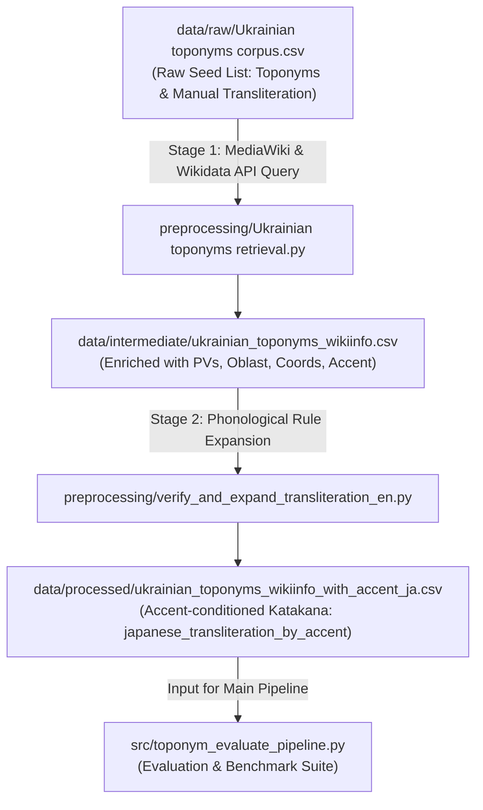

# Data Preprocessing Pipeline

This directory contains the Python scripts and procedures used to harvest, enrich, and linguistically verify the Ukrainian toponym datasets for this research project.

To maintain a strict separation of concerns, all datasets are maintained in `../data/`, while this directory houses only the algorithmic engines and procedural documentation.

---

## Workflow Overview



---

## Directory & File Responsibilities

### Preprocessing Scripts (`preprocessing/`)
| File | Role | Description |
| :--- | :--- | :--- |
| `Ukrainian toponyms retrieval.py` | Stage 1 Crawler | Queries MediaWiki & Wikidata APIs to harvest Wikipedia article metadata, coordinates, population, and pageviews. |
| `verify_and_expand_transliteration_en.py` | Stage 2 Linguistic Engine | Evaluates acute stress accents (`\u0301`) and applies Ukrainian-to-Japanese phonological adaptation rules. |
| `README.md` | Documentation | Theoretical rationale, execution guidelines, and linguistic rule specifications. |

### Data Storage Architecture (`data/`)
| Path | Status | Description |
| :--- | :--- | :--- |
| `data/raw/Ukrainian toponyms corpus.csv` | Raw Seed | Initial manual list of Ukrainian toponyms and baseline reference transcriptions. |
| `data/intermediate/ukrainian_toponyms_wikiinfo.csv` | Intermediate | Extracted metadata (pageviews, coordinates, oblast, population, Wikipedia acute accents). |
| `data/processed/ukrainian_toponyms_wikiinfo_with_accent_ja.csv` | Master Dataset | Fully enriched dataset containing rule-generated accent-aware Katakana transcriptions (`japanese_transliteration_by_accent`). Used by `src/`. |
| `data/processed/established_toponyms_table.csv` | Research Table | Toponyms exceeding the knee-point threshold identified as historically established. |

---

## Detailed Pipeline Stages

### Stage 1: Wikipedia & Wikidata Information Retrieval
**Script**: `Ukrainian toponyms retrieval.py`

This script automates data harvesting across Ukrainian Wikipedia and Wikidata:
1. **API Endpoints**:
   - Ukrainian Wikipedia MediaWiki API: `https://uk.wikipedia.org/w/api.php`
   - Wikidata Structured Data API: `https://www.wikidata.org/w/api.php`
2. **Metadata Harvested**:
   - **Pageviews**: 2-year average monthly pageviews (`avg_monthly_pv_2y`) via the Wikimedia REST API.
   - **Phonological Stress**: Unicode combining acute accent mark (`\u0301`) parsed from Wiktionary/Wikipedia phonetic headers.
   - **Administrative Division**: Ukrainian Oblast (24 oblasts + Kyiv / Sevastopol / Crimea) disambiguated via category hierarchies and administrative templates.
   - **Geographic Data**: Latitude, longitude, settlement classification (city, town, village), and latest population figures.
   - **Interwiki Japanese Links**: Corresponding Japanese Wikipedia title (`ja_wiki_title`) and URL (`ja_wiki_url`), if an existing established article exists.

**Execution**:
```bash
cd preprocessing
python "Ukrainian toponyms retrieval.py" "../data/raw/Ukrainian toponyms corpus.csv"
mv ukrainian_toponyms_wikiinfo.csv ../data/intermediate/
```

---

### Stage 2: Phonological Rule Verification & Accent-Based Transliteration
**Script**: `verify_and_expand_transliteration_en.py`

Standard Cyrillic orthography omits accentuation, leading to ambiguous syllable weighting in Japanese transcription. This script evaluates the stress accent (`\u0301`) present in `toponym_with_accent` and applies deterministic phonological conversion rules into Katakana.

#### Key Linguistic Adaptations:
1. **Accent-Conditioned Gemination (促音 / ッ)**:
   - When a consonant from `GEMINATE_CONSONANTS` (`б, в, г, ґ, д, ж, з, к, л, м, п, р, с, т, ф, х, ц, ч, ш, щ`) is doubled immediately following a stressed vowel, it is realized with Japanese sokuon (`ッ`).
   - Exception: Doubled `нн` is adapted as moraic nasal `ン` + Na-row mora.
2. **Regressive Voicing Assimilation (無声化・有声化の同化規則)**:
   - Voiceless obstruents (`п, т, к, ф, с, ш, х, ц, ч`) immediately preceding voiced obstruents (`б, д, ґ, з, ж, г`) assimilate to their voiced counterparts (e.g., $t + b \rightarrow d + b$).
3. **Iotated Vowels & Palatalization (口蓋化母音)**:
   - Ukrainian iotated vowels (`я, ю, є, ї`) are decomposed contextually:
     - Word-initial / post-vocalic: full diphthong (`ヤ, ユ, イェ, イィ`).
     - Post-consonantal: palatalized contracted sounds (拗音, e.g., `ля` $\rightarrow$ `リャ`, `дя` $\rightarrow$ `ジャ`/`ヂャ`).
4. **Coda & Labial Consonant Resolution**:
   - Ukrainian coda `в` without a subsequent vowel is adapted to `ウ` (e.g., *Харків* $\rightarrow$ *ハルキウ*).
   - Word-internal `в` preceding an apostrophe (hard sign, e.g., *Слов'янськ*) preserves the labiodental approximant `ヴ` (*スロヴヤンシク*).
   - Nasal coda `м` assimilates to moraic nasal `ン` before labials (`б, п, в, ф, м`), but remains `ム` before other consonants and at word boundaries.

**Execution**:
The script automatically reads from `../data/intermediate/ukrainian_toponyms_wikiinfo.csv` and outputs directly to `../data/processed/ukrainian_toponyms_wikiinfo_with_accent_ja.csv`:
```bash
cd preprocessing
python verify_and_expand_transliteration_en.py
```
