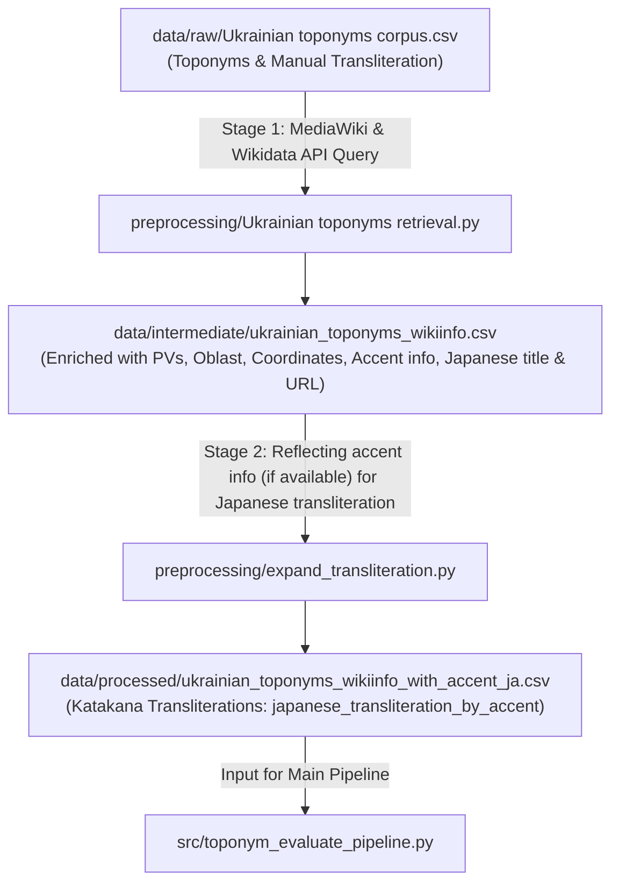

# Data Preprocessing Pipeline

This directory contains the Python scripts and procedures used to retrieve and enrich the Ukrainian toponym datasets, retrieveing the data from Ukrainian Wikipedia and Wikidata.

To maintain a separation between the datasets and the pipeline, all datasets are maintained in `../data/`, while this directory has only the algorithmic engines and procedural documentation.

---

## Workflow Overview



---

## Directory & File Responsibilities

### Preprocessing Scripts (`preprocessing/`)
| File | Role | Description |
| :--- | :--- | :--- |
| `Ukrainian toponyms retrieval.py` | Stage 1 Retrieval  | Queries MediaWiki & Wikidata APIs to retrieve Wikipedia article metadata, coordinates, population, and pageviews. |
| `expand_transliteration.py` | Stage 2 Linguistic Processing | Evaluates acute stress accents (`\u0301`) and applies phonological rules for accent-conditioned Katakana transliterations. |

### Data Storage Architecture (`data/`)
| Path | Status | Description |
| :--- | :--- | :--- |
| `data/raw/Ukrainian toponyms corpus.csv` | Raw Data | Initial manual list of Ukrainian toponyms. |
| `data/intermediate/ukrainian_toponyms_wikiinfo.csv` | Intermediate Data | Extracted metadata (pageviews, coordinates, oblast, population, Wikipedia acute accents). |
| `data/processed/ukrainian_toponyms_wikiinfo_with_accent_ja.csv` | Master Dataset | Enriched dataset containing rule-generated accent-aware Katakana transliterations (`japanese_transliteration_by_accent`). Used by `toponym_evaluate_pipeline.py`. |

---

## Detailed Pipeline Stages

### Stage 1: Wikipedia & Wikidata Information Retrieval
**Script**: `Ukrainian toponyms retrieval.py`

This script retrieves data from Ukrainian Wikipedia and Wikidata:
1. **API Endpoints**:
   - Ukrainian Wikipedia MediaWiki API: `https://uk.wikipedia.org/w/api.php`
   - Wikidata Structured Data API: `https://www.wikidata.org/w/api.php`
2. **Retrieved Information**:
   - **Pageviews**: Average monthly pageviews (`avg_monthly_pv_2y`) over the past 2 years via the Wikimedia REST API.
   - **Accent information**: Unicode combining acute accent mark (`\u0301`) parsed from Ukrainian Wiktionary/Wikipedia (if available).
   - **Administrative Division**: Ukrainian Oblast (24 oblasts + Kyiv / Sevastopol / Crimea) disambiguated via category hierarchies and administrative information.
   - **Geographic Data**: Latitude, longitude, settlement classification (city, town, village), and latest population figures.
   - **Interwiki Japanese Links**: Corresponding Japanese Wikipedia title (`ja_wiki_title`) and URL (`ja_wiki_url`), if an existing established article exists.

**Execution**:
```bash
cd preprocessing
python "Ukrainian toponyms retrieval.py" "../data/raw/Ukrainian toponyms corpus.csv"
mv ukrainian_toponyms_wikiinfo.csv ../data/intermediate/
```

---

### Stage 2: Accent-Based Katakana Transliteration
**Script**: `expand_transliteration.py`

This script evaluates the stress accent (`\u0301`) present in `toponym_with_accent` and applies phonological conversion rules into Katakana.

#### Key Phonological Adaptations:
1. **Gemination & Stress Interaction**:
   - When a consonant from `GEMINATE_CONSONANTS` (`б, в, г, ґ, д, ж, з, к, л, м, п, р, с, т, ф, х, ц, ч, ш, щ`) is doubled, `ッ` is always inserted immediately preceding the doubled consonant (replacing the prolonged sound mark `ー` even when the preceding vowel is stressed, e.g., *Запорі́жжя* $\rightarrow$ *ザポリッジャ*).
   - Exception: Doubled `нн` is adapted as moraic nasal `ン` + Na-row (`ナ`, `ニ`, `ヌ`, `ネ`, `ノ`, or `ヌィ` for `нни`, e.g., *Ві́нниця* $\rightarrow$ *ヴィーンヌィツャ*).
2. **Regressive Voicing & Coronal Cluster Assimilation**:
   - Voiceless consonants (`п, т, к, ф, с, ш, х, ц, ч`) immediately preceding voiced consonants (`б, д, ґ, з, ж, г`) assimilate to their voiced counterparts (`б, д, ґ, в, з, ж, г, дз, дж`, e.g., *Ви́шгород*: `шг` $\rightarrow$ `жг` $\rightarrow$ *ヴィージュホロド*).
   - Coronal clusters `дськ` and `тськ` assimilate to `цьк` (e.g., *Білово́дськ* $\rightarrow$ *ビロヴォーツィク*).
3. **Iotated Vowels, Palatalization & Non-Palatalized `и`**:
   - Ukrainian iotated vowels (`я, ю, є, ї`) are treated as follows:
     - At the beginning of the word, after vowels, or after an apostrophe: (`ヤ, ユ, イェ, イィ`).
     - After consonants: palatalized contracted sounds (拗音, e.g., `ля` $\rightarrow$ `リャ`, `тя` $\rightarrow$ `テャ`, `дя` $\rightarrow$ `デャ`, `ця` $\rightarrow$ `ツャ`).
   - Non-palatalized consonants followed by `и` are mapped to hard-vowel digraphs (`ブィ, グィ, ドィ, ズィ, クィ, ルィ, ムィ, ヌィ, プィ, スィ, トィ, ツィ`).
4. **Coda, Labial Consonant & Prosodic Resolution**:
   - `в` at the end of the word or before a consonant is adapted to `ウ` (e.g., *Ха́рків* $\rightarrow$ *ハールキウ*).
   - `в` before a hard sign (`в'`, e.g., *Слов'я́нськ*) preserves the labiodental approximant `ヴ` (*スロヴヤーンシク*).
   - Nasal coda `м` assimilates to moraic nasal `ン` before labials (`б, п, в, ф, м`), but remains `ム` before other consonants and at the end of the word.
   - Stressed vowels receive `ー`, vowel + `й` sequences (`-ий`, `-ій` before a consonant or word-end) lengthen to `ー`, and monosyllabic words (except the unstressed preposition `за`) automatically receive `ー`. Multi-word spaces become `・` and hyphens `-` become `＝`.

**Execution**:
The script automatically reads from `../data/intermediate/ukrainian_toponyms_wikiinfo.csv` and outputs directly to `../data/processed/ukrainian_toponyms_wikiinfo_with_accent_ja.csv`:
```bash
cd preprocessing
python expand_transliteration.py
```